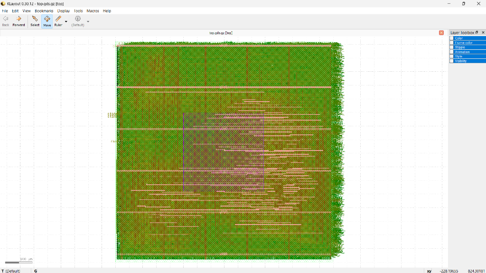

# 32-Bit Multi-Cycle RISC-V Microcontroller Core (`RV32I_Zmmul` with Hardware CRC)

A synthesizable 32-bit multi-cycle RISC-V processor core hardened for the **SkyWater 130nm CMOS PDK (sky130_fd_sc_hd)** via the automated OpenLane RTL-to-GDSII ASIC design flow.

Engineered for resource-constrained embedded edge processing, the microarchitecture maximizes silicon area efficiency through temporal hardware sharing across an **8-state finite state machine (FSM)**.

---

## 🏛️ Physical ASIC Implementation & Die Metrics

<p align="center">
  
  <br>
  <em>Figure 1: Full-chip physical layout in KLayout showing standard cell rows, central multiplier/ALU congestion block, and horizontal power distribution (PDN) straps.</em>
</p>

The core was synthesized, placed, and routed using the automated **OpenLane RTL-to-GDSII flow** targeting the SkyWater 130nm open-source PDK.

| Metric | Physical Measurement / Specification |
| :--- | :--- |
| **Process Node** | SkyWater 130nm CMOS (`sky130_fd_sc_hd`) |
| **Die Dimensions** | **$798.3\ \mu\text{m} \times 809.0\ \mu\text{m}$** ($0.798\text{ mm} \times 0.809\text{ mm}$) |
| **Total Die Area** | **$0.646\text{ mm}^2$** (~size of two grains of table salt; >300 dies fit on a 5-cent coin) |
| **Core Target Density** | **$37.0\%$** standard cell placement density |
| **Clock Frequency / Period**| **$20.0\text{ MHz}$** ($50.0\text{ ns}$ target clock period) |
| **Metal Stack** | 5-Metal Routing Stack (`met1` through `met5`) |
| **Antenna Protection** | Diode Insertion Strategy 3 (`GRT_REPAIR_ANTENNAS = true`) |
| **Tapeout Deliverable** | Tapeout-ready GDSII stream file (`openlane/top.gds.gz`) |

### Inspecting the Physical Layout:
The complete post-routing GDSII stream file is included in `openlane/top.gds.gz`. To view in [KLayout](https://www.klayout.de/):
```bash
# Decompress layout stream
gzip -d openlane/top.gds.gz

# Open in KLayout layout viewer
klayout openlane/top.gds
```

---

## ⚙️ Microarchitecture & Resource Sharing

In contrast to single-cycle or pipelined designs that duplicate computational blocks, this multi-cycle architecture reuses a single 32-bit ALU across distinct execution phases:
1. **Instruction Fetch & Program Counter Increment:** Computes $PC + 4$.
2. **Branch & Jump Target Calculation:** Computes $PC + \text{imm}$.
3. **Effective Memory Address Computation:** Computes $\text{Base} + \text{Offset}$ for load and store instructions.
4. **General Arithmetic & Logic:** Executes R-type and I-type integer operations.

```
                  +--------------------------------------------------------+
                  |               MULTI-CYCLE CORE ARCHITECTURE            |
                  |                                                        |
   +--------+     |   +-------------------+          +-----------------+   |
   |   PC   |-------->|   Memory Arbiter  |--------->| Instruction Reg |   |
   +--------+     |   +-------------------+          +-----------------+   |
       ^          |             |                             |            |
       |          |             v                             v            |
       |          |   +-------------------+          +-----------------+   |
       +--------------| 8-State FSM Unit  |<-------->| Decode & Control|   |
                  |   +-------------------+          +-----------------+   |
                  |             |                             |            |
                  |             v                             v            |
                  |   +-------------------+          +-----------------+   |
                  |   |   Register File   |--------->| Multiplier / ALU|   |
                  |   |   (32 x 32-bit)   |          |  (Resource Mux) |   |
                  |   +-------------------+          +-----------------+   |
                  |             |                             |            |
                  |             v                             v            |
                  |   +-------------------+          +-----------------+   |
                  |   |  Load/Store Unit  |<-------->| CRC Accelerator |   |
                  |   | (Byte Steering)   |          | (16-bit Engine) |   |
                  |   +-------------------+          +-----------------+   |
                  +--------------------------------------------------------+
```

### 8-State Finite State Machine (FSM):
1. `FETCH`: Fetches instruction word from instruction memory via Program Counter.
2. `DECODE`: Decodes opcode/funct fields, reads register operands, and computes branch target.
3. `EXECUTE`: Executes ALU arithmetic, logical operations, or evaluates branch conditions.
4. `BRANCH`: Commits updated target address to Program Counter on taken branches.
5. `MEM_ADDR`: Computes data memory effective address ($rs1 + \text{imm}$).
6. `MEM_ACCESS`: Executes memory write for stores; reads from SRAM for loads.
7. `LOAD_WB`: Load/Store Unit (LSU) sign/zero-extends data and commits word/half/byte to destination register.
8. `WRITE_BACK`: Commits ALU or Multiplier calculation result to register file.

---

## 📜 ISA Specification & Extended Units

The core implements **47 total instructions** with verified 100% ISA functional coverage:

- **RV32I Base Integer:** All 37 standard integer arithmetic, logical, branch, jump, load, and store operations.
- **Zmmul Standard Extension:** High-performance hardware multiplication (`mul`, `mulh`, `mulhsu`, `mulhu`) producing 64-bit product outputs.
- **Hardware CRC-16 Acceleration Unit:** Zero-latency CRC calculation engine implementing CRC-16 CCITT polynomial (`0x1021`) across byte, halfword, and word operands (`crcb`, `crch`, `crcw`).
- **Load/Store Unit (LSU):** Supports byte-level write masking and automatic sign/zero-extension (`lb`, `lh`, `lw`, `lbu`, `lhu`, `sb`, `sh`, `sw`).

---

## 🧪 Verification & Simulation

The core is accompanied by modular unit testbenches and an end-to-end firmware verification suite (`tb/tb_basic_cpu_validation.v`) executing a 952-cycle comprehensive firmware benchmark.

### Running Simulation via Command Line
```powershell
# Navigate to repository root
cd rv32i-multicycle-core

# Run one-click compilation and execution script (Windows)
.\sim\run_validation.bat

# Or run manually via Icarus Verilog
iverilog -o sim.vvp rtl/*.v tb/tb_basic_cpu_validation.v
vvp sim.vvp
```

### Expected Output:
```text
================================================
OFFICIAL VALIDATION FIRMWARE RESULT
================================================
cycles = 952
PC     = 004003f0
OldPC  = 004003ec
x4     = 00000000
PASS: OFFICIAL VALIDATION FIRMWARE PASSED
================================================
```

---

## 📂 Repository Structure
```
rv32i-multicycle-core/
├── rtl/                        # Synthesizable Verilog modules
│   ├── addr_decoder.v          # Memory space address decoder
│   ├── alu.v                   # 32-bit arithmetic logic unit
│   ├── basic_cpu.v             # Core top-level interconnect
│   ├── branch_comp.v           # Signed/unsigned branch comparator
│   ├── control_unit.v          # 8-state multi-cycle FSM controller
│   ├── crc.v                   # CRC-16 hardware engine (CCITT 0x1021)
│   ├── dmem.v                  # 8KB data SRAM memory
│   ├── imem.v                  # 4MB instruction ROM
│   ├── imm_gen.v               # Immediate value generator
│   ├── instruction_register.v  # Instruction holding register
│   ├── lsu.v                   # Load/store unit with byte steering
│   ├── multiplier.v            # 32-bit hardware multiplier (Zmmul)
│   ├── program_counter.v       # Program counter register
│   └── reg_file.v              # 32x32 register file
├── openlane/                   # Physical ASIC hardening files
│   ├── config.json             # OpenLane floorplan & synthesis settings
│   ├── top.gds.gz              # Tapeout GDSII stream file (78 MB uncompressed)
│   └── top.nl.v                # Post-routing gate-level netlist
├── tb/                         # Unit testbenches
│   ├── tb_basic_cpu_validation.v   # 952-cycle firmware validation TB
│   ├── tb_basic_cpu_branch.v       # Branch verification TB
│   ├── tb_basic_cpu_multiplier.v   # Hardware multiplier TB
│   └── tb_basic_cpu_crc_special.v  # CRC hardware engine TB
├── firmware/                   # Firmware binaries & sources
│   ├── firmware_validation.hex     # 952-cycle validation binary
│   └── firmware.s                  # Assembly verification source
├── sim/
│   └── run_validation.bat      # One-click Windows simulation script
├── .gitignore
└── README.md
```

---

## 👤 Author
**Lee Ern De**  
Department of Electrical & Electronics Engineering  
Faculty of Engineering, Universiti Malaya (UM)  
National Finalist, ChampionCHIP eXperience ASIC Design Contest (2026)  
LinkedIn: [linkedin.com/in/ern-de-lee-106b953ab](https://linkedin.com/in/ern-de-lee-106b953ab)
